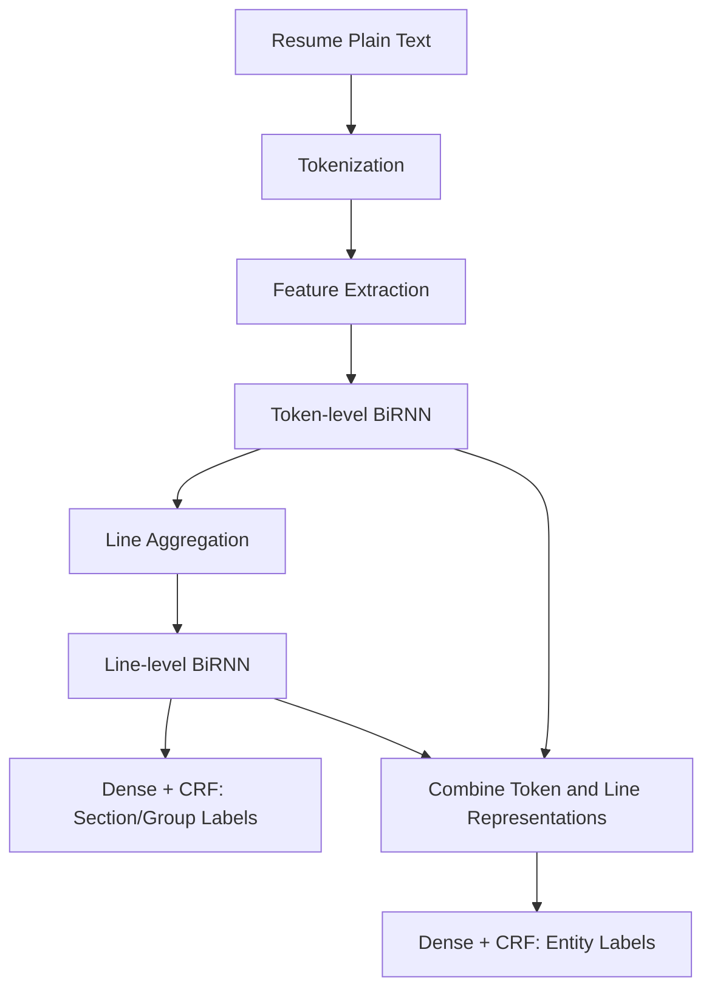
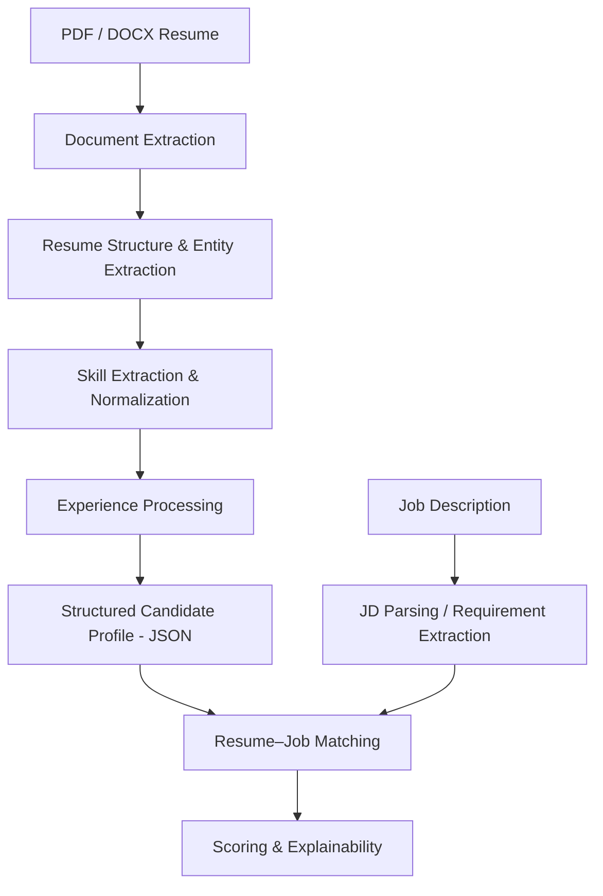

# PAPER REVIEW 01 — Résumé Parsing as Hierarchical Sequence Labeling: An Empirical Study

> **Chủ đề:** Resume Parsing / Information Extraction  
> **Năm công bố:** 2023  
> **Tác giả:** Federico Retyk, Hermenegildo Fabregat, Juan Aizpuru, Mariana Taglio, Rabih Zbib  
> **Công bố:** RecSys in HR'23 Workshop, thuộc ACM RecSys 2023  
> **Bài báo:** https://arxiv.org/pdf/2309.07015  
> **DOI:** https://doi.org/10.48550/arXiv.2309.07015  
> **GitHub được bài báo dẫn:** https://github.com/federetyk/resume-parsing  
> **Phạm vi liên quan:** Resume Parsing; không trực tiếp giải quyết Resume–Job Matching hoặc tính điểm CV–JD.

## 1. Xác định bài toán nghiên cứu và mục tiêu

### 1.1. Bài toán nghiên cứu

Bài báo nghiên cứu việc **tự động trích xuất thông tin có cấu trúc từ CV không đồng nhất về bố cục, nội dung và ngôn ngữ**. Một CV thường chứa các phần như thông tin liên hệ, học vấn, kinh nghiệm làm việc và kỹ năng, nhưng cách tổ chức và trình bày khác nhau đáng kể giữa các ứng viên.

Một cách xử lý truyền thống là tách thành hai bước:

1. **Section Segmentation:** Nhận diện các phần của CV (ví dụ: Contact Information, Work Experience, Education, Skills).
2. **Entity Extraction:** Trích xuất các thực thể cụ thể (ví dụ: họ tên, email, vị trí công việc, công ty, khoảng thời gian làm việc).

Nhược điểm của cách tách rời là cần duy trì nhiều mô hình hoặc bước xử lý, trong khi lỗi phân đoạn có thể ảnh hưởng đến chất lượng nhận diện thực thể phía sau.

### 1.2. Mục tiêu nghiên cứu

Các tác giả khảo sát cách mô hình hóa Resume Parsing dưới dạng **Hierarchical Sequence Labeling**, kết hợp hai cấp độ dự đoán trong một kiến trúc:

- **Line-level Sequence Labeling:** Nhận diện section và group của CV theo từng dòng.
- **Token-level Sequence Labeling:** Nhận diện thực thể theo từng token.

Mục tiêu là đánh giá chất lượng trích xuất, lợi ích của ngữ cảnh xuyên dòng, các lựa chọn biểu diễn văn bản và đánh đổi giữa độ chính xác với chi phí tính toán.

**Kết luận tiêu chí 1:** Đây là nghiên cứu về *Information Extraction*, tập trung kết hợp nhận diện cấu trúc và thực thể của CV, không phải nghiên cứu chấm điểm mức độ phù hợp CV–JD.

---

## 2. Đầu vào và đầu ra của mô hình

### 2.1. Đầu vào (Input)

Đầu vào trực tiếp là **văn bản CV đã chuyển thành plain text**, không phải file PDF/DOCX thô. Bài báo sử dụng công cụ bên thứ ba để chuyển đổi tài liệu sang văn bản; bước chuyển đổi tài liệu không phải trọng tâm đóng góp.

Ví dụ đầu vào minh họa:

```text
Nguyen Van A
Email: example@gmail.com

WORK EXPERIENCE
Backend Developer
ABC Technology
Jan 2022 - Dec 2024
Developed REST APIs using Node.js

EDUCATION
University of Technology
Bachelor of Software Engineering

SKILLS
Node.js, TypeScript, PostgreSQL
```

### 2.2. Đầu ra (Output)

Mô hình dự đoán hai nhóm nhãn:

- **Line-level:** Nhãn section/group cho các dòng (nghiên cứu định nghĩa 18 nhãn ở cấp này).
- **Token-level:** Nhãn thực thể thông tin cho các token (nghiên cứu định nghĩa 17 loại thực thể).

Sau hậu xử lý, ứng dụng có thể chuyển các nhãn thành JSON như sau:

```json
{
  "name": "Nguyen Van A",
  "email": "example@gmail.com",
  "work_experience": [
    {
      "job_title": "Backend Developer",
      "company": "ABC Technology",
      "period": "Jan 2022 - Dec 2024"
    }
  ],
  "education": [
    {
      "school": "University of Technology",
      "degree": "Bachelor of Software Engineering"
    }
  ]
}
```

> **Lưu ý:** JSON này chỉ minh họa cách ứng dụng có thể biểu diễn thông tin sau hậu xử lý, **không phải định dạng đầu ra nguyên bản được bài báo công bố**.

Mặc dù có section **Skills**, danh sách nhãn token-level của nghiên cứu không có một nhãn chuyên biệt cho từng kỹ năng như `Node.js`, `Python` hay `Docker`. Do đó, không thể xem bài báo đã giải quyết trọn vẹn bài toán Skill Extraction.

**Kết luận tiêu chí 2:** Input là CV dạng văn bản; output là nhãn cấu trúc và thực thể. Hệ thống thực tế còn cần document extraction và hậu xử lý thành dữ liệu có cấu trúc.

---

## 3. Phương pháp và kiến trúc chính

### 3.1. Kiến trúc tổng quan

Mô hình sử dụng **BiRNN + CRF** và kết hợp biểu diễn token với biểu diễn dòng. Có thể tóm tắt biến thể multi-task bằng sơ đồ logic sau:



Sơ đồ là diễn giải giản lược cho mục đích đọc hiểu: nhánh dự đoán token tận dụng cả biểu diễn token và ngữ cảnh cấp dòng.

### 3.2. Vai trò từng thành phần

| Thành phần | Vai trò |
|---|---|
| **FastText** | Tạo vector biểu diễn từ, có thể kết hợp các handcrafted features. |
| **T5 / mT5 encoder** | Tạo biểu diễn token có ngữ cảnh; trong thiết lập chính encoder được giữ cố định. |
| **BiRNN** | Học ngữ cảnh hai chiều, gồm ngữ cảnh giữa các dòng trong CV. |
| **Line Aggregator** | Tổng hợp biểu diễn token thành biểu diễn dòng. |
| **CRF** | Dự đoán nhãn theo chuỗi, xét quan hệ giữa các nhãn liền kề. |
| **Multi-task Learning** | Học đồng thời nhãn section/group và entity trong cùng kiến trúc. |

### 3.3. Điểm đáng chú ý

Đóng góp quan trọng của bài báo không chỉ ở việc kết hợp BiRNN, CRF và các phương pháp embedding, mà còn ở **cách mô hình hóa chung hai nhiệm vụ nhận diện cấu trúc và trích xuất thực thể**.

Thay vì coi từng dòng hoặc từng section là độc lập, mô hình khai thác thông tin xuyên dòng để xác định vai trò của các token trong ngữ cảnh CV. Kết quả ablation cho thấy BiRNN học ngữ cảnh có ảnh hưởng lớn đến hiệu quả; CRF cũng giúp cải thiện thêm nhưng nhỏ hơn.

**Kết luận tiêu chí 3:** Nên tập trung tìm hiểu kiến trúc multi-task hierarchical sequence labeling và vai trò của ngữ cảnh nhiều cấp độ, thay vì chỉ ghi nhớ tên các thành phần kỹ thuật.

---

## 4. Dataset và metric đánh giá

### 4.1. Dataset

Bài báo sử dụng 7 bộ dữ liệu CV theo 7 ngôn ngữ, với tổng **5.994 CV**. Tài liệu được lấy mẫu từ các nguồn tuyển dụng công khai và gán nhãn thủ công.

| Ngôn ngữ | Số CV | Dòng/CV trung bình | Token/CV trung bình |
|---|---:|---:|---:|
| English | 1.196 | 73,3 | 834,1 |
| French | 1.044 | 54,4 | 539,1 |
| Chinese | 1.023 | 50,6 | 664,8 |
| Spanish | 846 | 68,6 | 667,4 |
| German | 738 | 80,5 | 608,6 |
| Portuguese | 628 | 73,1 | 773,6 |
| Swedish | 519 | 74,5 | 632,0 |
| **Tổng** | **5.994** | — | — |

Theo mô tả nghiên cứu, mỗi ngôn ngữ có 2–3 người tham gia gán nhãn và có quá trình đối chiếu, xử lý bất đồng. Mức độ nhất quán giữa người gán nhãn (Inter-Annotator Agreement, đo bằng F1) dao động từ **84,23% đến 94,35%**.

**Khả năng truy cập dataset:** Bài báo mô tả bộ dữ liệu nhưng không cung cấp đường dẫn công khai để tải đầy đủ 5.994 CV có nhãn. Không nên giả định có thể trực tiếp tải về và tái lập toàn bộ thực nghiệm.

### 4.2. Cách chia dữ liệu

- **Training:** 90% CV.
- **Testing:** 10% CV.
- Không báo cáo tập validation độc lập trong cách chia dữ liệu chính.
- Kết quả tính trung bình qua ba lần chạy với random seed khác nhau.

### 4.3. Metric

Tác giả sử dụng **micro-averaged F1-score** trên các nhãn dương, đánh giá riêng nhiệm vụ token-level và line-level.

$$
Precision = \frac{TP}{TP + FP}
$$

$$
Recall = \frac{TP}{TP + FN}
$$

$$
F1 = \frac{2 \times Precision \times Recall}{Precision + Recall}
$$

Trong đó:

- **Precision:** Trong các nhãn dương được dự đoán, tỷ lệ nào là đúng.
- **Recall:** Trong các nhãn dương thực tế, tỷ lệ nào được phát hiện đúng.
- **F1-score:** Trung bình điều hòa của Precision và Recall.

**Kết luận tiêu chí 4:** Dataset đa ngôn ngữ có nhãn nhưng không gồm tiếng Việt; cần xây dựng một bộ dữ liệu đánh giá riêng nếu ứng dụng cho CV tiếng Việt/tiếng Anh hoặc CV pha trộn ngôn ngữ.

---

## 5. Kết quả thực nghiệm quan trọng

### 5.1. Kết quả Token-level F1 theo ngôn ngữ

Dưới đây là bảng kết quả multi-task token-level F1 từ các số liệu được phân tích (đơn vị: %):

| Ngôn ngữ | FastText Multi-task | Transformer Multi-task |
|---|---:|---:|
| English | 89,03 | **90,94** |
| French | 86,90 | **88,65** |
| Chinese | **92,66** | 92,61 |
| Spanish | 88,77 | **90,24** |
| German | **87,43** | 86,13 |
| Portuguese | 89,14 | **90,05** |
| Swedish | **89,14** | 81,15 |

**Nhận xét:**

- Transformer Multi-task tốt hơn ở English, French, Spanish và Portuguese.
- FastText Multi-task tốt hơn ở German, Swedish và cao hơn rất ít ở Chinese.
- Transformer không mặc nhiên tốt hơn trong tất cả tập dữ liệu và ngôn ngữ.

### 5.2. Hiệu năng xử lý và tài nguyên

Các kết quả đánh giá hiệu năng được phân tích từ bài báo:

- FastText được báo cáo **nhanh khoảng 7 lần trên GPU** so với thiết lập Transformer tương ứng.
- FastText được báo cáo **nhanh khoảng 90 lần trên CPU**.
- **Latency FastText Multi-task trên CPU:** khoảng **450 ms** trong thiết lập thử nghiệm được báo cáo.

> Đây là **số liệu đo trong môi trường thực nghiệm của tác giả**, không phải cam kết latency hay tỷ lệ tăng tốc trên hạ tầng self-host bất kỳ.

### 5.3. Ablation Study — Token-level F1 trên dữ liệu English

| Kiến trúc | Token-level F1 |
|---|---:|
| FastText + CRF | 65,89% |
| FastText + BiRNN + Softmax | 88,86% |
| FastText + BiRNN + CRF | 89,03% |
| BERT + BiRNN + CRF | 88,91% |
| **T5 + BiRNN + CRF** | **90,94%** |

**Diễn giải:**

- Bổ sung BiRNN đem lại cải thiện lớn so với chỉ dùng FastText + CRF.
- CRF mang lại cải thiện thêm nhưng nhỏ hơn.
- T5 + BiRNN + CRF đạt F1 cao nhất trong các cấu hình được liệt kê cho tiếng Anh.

**Kết luận tiêu chí 5:** Nếu ưu tiên chất lượng mô hình trên dữ liệu tương tự tập tiếng Anh trong nghiên cứu, T5 + BiRNN + CRF là ứng viên đáng thử nghiệm. Nếu ưu tiên chi phí, latency và triển khai CPU, FastText + BiRNN + CRF đáng được xem xét.

---

## 6. Hạn chế và điều kiện áp dụng

| Hạn chế | Ảnh hưởng đến hệ thống của mình |
|---|---|
| Không xử lý trực tiếp PDF/DOCX | Cần module document extraction trước NLP. |
| Không có dữ liệu tiếng Việt | Chưa thể kết luận mô hình hiệu quả tương đương trên CV tiếng Việt. |
| Không nhận diện từng skill bằng nhãn chuyên biệt | Phải triển khai thêm Skill Extraction/Normalization. |
| Không giải quyết Resume–Job Matching | Cần thuật toán matching riêng. |
| Dataset không được công khai đầy đủ | Khó tái lập nguyên trạng thí nghiệm và so sánh trực tiếp. |
| Số lượng CV theo từng ngôn ngữ còn giới hạn | Rủi ro suy giảm chất lượng khi gặp bố cục, ngành nghề hoặc nhóm hồ sơ khác. |
| Transformer có chi phí tính toán cao hơn | Cần đánh giá CPU/GPU, RAM và latency khi self-host. |
| Không đánh giá trực tiếp số năm kinh nghiệm hoặc điểm CV–JD | Phải thiết kế metric và ground truth riêng cho các chức năng này. |

Những điều kiện nên kiểm chứng trước khi áp dụng:

1. Khả năng chuyển đổi PDF/DOCX sang plain text và giữ được thứ tự thông tin.
2. Mức độ tương đồng giữa CV đầu vào của sản phẩm với các CV trong nghiên cứu.
3. Chất lượng trên CV tiếng Việt, tiếng Anh và trộn ngôn ngữ.
4. Dữ liệu có nhãn và quy trình kiểm thử đủ tin cậy.
5. Chi phí thực thi trên hạ tầng self-host dự kiến.

**Kết luận tiêu chí 6:** Đây là nền tảng nghiên cứu tốt cho Resume Parsing, nhưng chưa phải giải pháp trọn gói cho chức năng phân tích CV và đối sánh JD.

---

## 7. Bài học và quyết định cho hệ thống

### 7.1. Mức độ liên quan với các module

| Module | Mức độ liên quan | Quyết định |
|---|---|---|
| **Resume Parsing** | Cao | Tham khảo trực tiếp kiến trúc nhận diện section và entity. |
| **Skill Extraction** | Trung bình | Có thể tận dụng section `Skills`, cần mô hình/phương pháp trích xuất skill riêng. |
| **JD Extraction** | Gián tiếp | Tham khảo sequence labeling, nhưng chưa được bài báo chứng minh cho JD. |
| **Resume–Job Matching** | Không trực tiếp | Không dùng làm bằng chứng chọn thuật toán matching. |
| **Scoring Engine** | Không trực tiếp | Phải nghiên cứu và triển khai độc lập. |

### 7.2. Kiến trúc đề xuất cho pipeline sản phẩm



**Vai trò của các thành phần:**

- **Document Extraction:** Xử lý file PDF/DOCX (có thể thử `pdf-parse`, `mammoth` hoặc công cụ bảo toàn bố cục).
- **Resume Structure & Entity Extraction:** Nhận diện các phần và thực thể của CV. Đây là phần **tham khảo trực tiếp** bài báo.
- **Skill Extraction & Normalization:** Nhận diện kỹ năng, xử lý tên viết tắt, đồng nghĩa, chuẩn hóa kỹ năng.
- **Experience Processing:** Chuẩn hóa ngày tháng, tính thời gian làm việc, xử lý các kỳ kinh nghiệm chồng lấn.
- **JD Parsing / Requirement Extraction:** Trích xuất yêu cầu kỹ năng, số năm kinh nghiệm và các điều kiện khác trong JD.
- **Resume–Job Matching:** Tính mức độ khớp giữa các trường đã chuẩn hóa.
- **Scoring & Explainability:** Tổng hợp điểm và giải thích những yêu cầu được/không được đáp ứng.

> Sơ đồ này là **đề xuất cho hệ thống của mình**, không phải kiến trúc đầu-cuối mà bài báo khẳng định đã triển khai và đánh giá.

### 7.3. Có nên triển khai mô hình này ngay?

**Quyết định: Chưa triển khai toàn bộ ngay; giữ làm ứng viên cho giai đoạn prototype và benchmark.**

**Lý do:**

1. Cần hoàn thiện trước pipeline chuyển đổi tài liệu và chuẩn dữ liệu đầu ra.
2. Cần tập dữ liệu có nhãn đại diện cho CV tiếng Việt/tiếng Anh để kiểm chứng thay vì lấy F1 của bài báo làm chất lượng dự kiến của sản phẩm.
3. Nên có **baseline đơn giản**, chẳng hạn rule-based section detection + NER, trước khi thử nghiệm mô hình multi-task phức tạp.
4. Chỉ nên chọn mô hình chính thức sau khi so sánh trên cùng bộ dữ liệu, metric và môi trường chạy.

**Kết luận tiêu chí 7:** Giữ bài báo làm cơ sở kiến trúc Resume Parsing và ứng viên thử nghiệm. Không sử dụng để kết luận về hiệu quả Skill Extraction chuyên biệt, JD Matching hoặc Scoring Engine.

---

## 8. Source code và khả năng tái lập thực nghiệm

- **Repository được dẫn:** https://github.com/federetyk/resume-parsing
- **Nội dung được ghi nhận khi phân tích:** README, giấy phép MIT, tài liệu hoặc ví dụ về handcrafted features.
- **Giới hạn:** Không thấy công khai đầy đủ toàn bộ mã nguồn triển khai mô hình, training pipeline, pretrained weights và bộ dữ liệu có nhãn.

**Phân loại repository:** *Supplementary Materials* — tài liệu bổ trợ, **chưa đủ cơ sở xem là code hoàn chỉnh để clone và chạy lại toàn bộ thí nghiệm**.

**Tác động đến kế hoạch thực nghiệm:** Nếu muốn tái lập kiến trúc này, cần tự triển khai các thành phần còn thiếu hoặc tìm thêm mã nguồn/mô hình tương đương. Mọi kết quả thu được khi triển khai lại cần báo cáo như thí nghiệm của mình, không đồng nhất với kết quả gốc.

---

## 9. Checklist hoàn thành 7 tiêu chí

- [x] **Xác định bài toán và mục tiêu:** Hierarchical Resume Parsing, dự đoán đồng thời nhãn cấu trúc và thực thể.
- [x] **Hiểu đầu vào và đầu ra:** CV plain text → section/group và entity labels.
- [x] **Giải thích phương pháp/kiến trúc:** Multi-task BiRNN + CRF, với đặc trưng FastText hoặc T5/mT5.
- [x] **Biết dataset và metrics:** 5.994 CV, 7 ngôn ngữ, chia 90/10, micro-F1.
- [x] **Ghi kết quả thực nghiệm:** English token-F1 90,94% với T5; FastText có lợi thế tốc độ trong thiết lập thử nghiệm.
- [x] **Xác định hạn chế và điều kiện áp dụng:** Thiếu tiếng Việt, không giải quyết riêng skill extraction/matching, chưa có công khai đầy đủ dataset/code.
- [x] **Rút ra bài học/quyết định:** Giữ làm ứng viên Resume Parsing; benchmark với baseline trước khi lựa chọn.

---

## 10. Kết luận dùng cho Literature Review

Nghiên cứu *Résumé Parsing as Hierarchical Sequence Labeling: An Empirical Study* cho thấy có thể mô hình hóa bài toán Resume Parsing như một nhiệm vụ gán nhãn chuỗi theo cấu trúc phân cấp, kết hợp nhận diện section/group ở cấp dòng với nhận diện thực thể ở cấp token. Thay vì chỉ phân đoạn và trích xuất riêng lẻ, kiến trúc đa nhiệm tận dụng thông tin ngữ cảnh xuyên dòng, giúp cải thiện khả năng nhận diện các thành phần của CV. Kết quả thực nghiệm trên tập dữ liệu đa ngôn ngữ cho thấy việc lựa chọn biểu diễn văn bản, đặc biệt giữa FastText và Transformer, tạo ra sự đánh đổi đáng kể giữa độ chính xác và chi phí suy luận.

Đối với đề tài xây dựng dịch vụ Resume Parsing, Skill Extraction và Resume–Job Matching, đóng góp đáng kế thừa nhất là phương pháp nhận diện cấu trúc và thực thể CV theo nhiều cấp độ. Tuy vậy, nghiên cứu chưa giải quyết toàn bộ việc nhận diện từng kỹ năng, chuẩn hóa kinh nghiệm theo số năm, phân tích yêu cầu JD hoặc tính điểm phù hợp giữa CV và công việc. Vì vậy, hướng áp dụng hợp lý là sử dụng bài báo làm nền tảng tham khảo cho module Resume Parsing, kết hợp các nghiên cứu khác cho các module còn lại và tiến hành đánh giá thực nghiệm trên tập dữ liệu riêng trước khi lựa chọn kiến trúc chính thức.

### Kết luận nghiên cứu ngắn gọn

| Hạng mục | Quyết định |
|---|---|
| Giá trị nghiên cứu | Cao đối với Resume Parsing |
| Mô hình đáng thử nghiệm | T5 + BiRNN + CRF hoặc FastText + BiRNN + CRF |
| Có code đầy đủ để chạy lại? | Chưa xác nhận; repository công khai chỉ có tài liệu bổ trợ được ghi nhận |
| Có dataset công khai đầy đủ? | Chưa thấy đường dẫn tải bộ dữ liệu có nhãn |
| Có giải quyết Skill Extraction độc lập? | Không |
| Có giải quyết Resume–Job Matching? | Không |
| Quyết định cuối | Đưa vào danh sách ứng viên benchmark; chưa triển khai ngay |

---

## 11. Nguồn tham khảo và lưu ý sử dụng

1. Retyk, F., Fabregat, H., Aizpuru, J., Taglio, M., & Zbib, R. (2023). *Résumé Parsing as Hierarchical Sequence Labeling: An Empirical Study*. arXiv:2309.07015. https://arxiv.org/pdf/2309.07015
2. arXiv DOI: https://doi.org/10.48550/arXiv.2309.07015
3. GitHub repository: https://github.com/federetyk/resume-parsing

> **Ghi chú:** Các đoạn JSON, sơ đồ Mermaid và pipeline ứng dụng trong tài liệu này là ví dụ hoặc phần tổng hợp/đề xuất phục vụ triển khai; không nên trích dẫn chúng như kết quả thực nghiệm do tác giả báo cáo. Các con số thực nghiệm cần được đối chiếu lại với bảng tương ứng trong PDF khi sử dụng trong luận văn chính thức.
